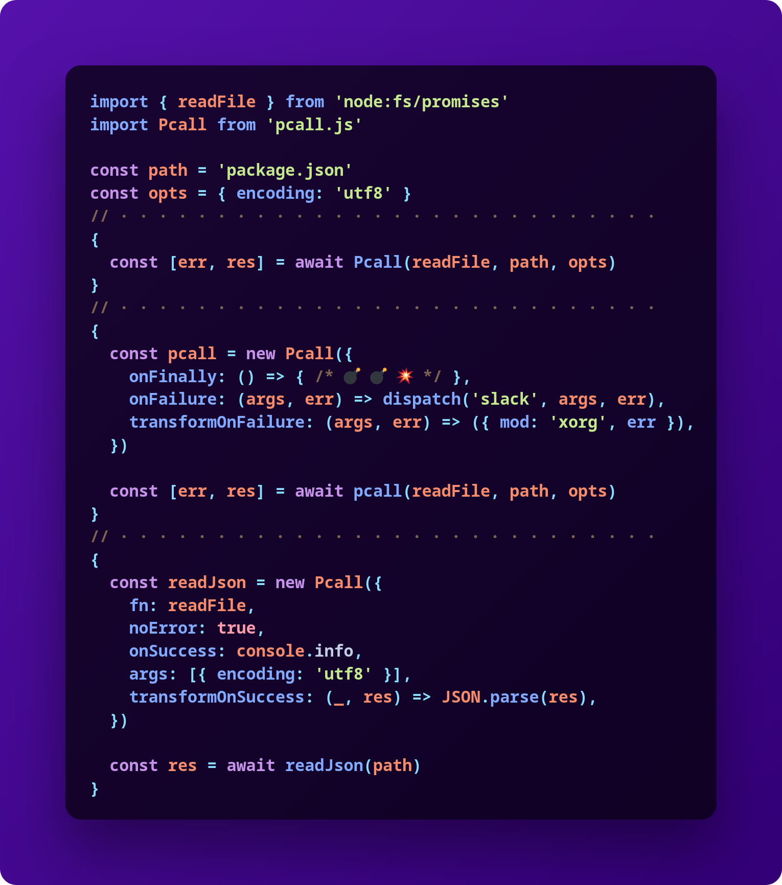

<div align="center">
  
  <h1>Ƥ𝖢𐤠LL<sub>.ᴊꜱ</sub></h1>
  <h3>Result/Monad like tuples for JS</h3>
  <h4>unwrap promises safely with minimum footprint</h4>
    ── ╶╴╶╴╶╴╶╴╶╴╶╴╶╴ ──
  <br>
  <p>📦 Extremely Small</p>
  <p>🧬 Lifecycle Hooks</p>
  <p>🎯 Concise Signature</p>
  <p>💠 Group Side Effects</p>
  <p>⛔ <s>try/catch</s> HELL 👹</p>
  <p>🌟 Better Visibility and Control</p>
  <p>🌐 Works in ESM & CJS</p>
  <p>✱ Minimal Obsessive Disorder</p>
</div>

---

<div align="center">
  
  <p><a href="https://github.com/metaory/pcall.js/blob/master/.github/assets/usage.js">usage.js</a></p>
</div>

---

Inspiration
-----------
 `pcall.js` is heavily inspired by

🔹 Lua `pcall` `status, res`

🔹 Elixir/Erlang Result Monad `{:ok/:error, reason/value}`

🔹 Rust `Result<T, E>`

🔹 Go `[]error`

**with superpowers** 🦄!

---

SYNOPSIS
--------
`pcall({f}, {arg1}, {...})`

`[err, res]`


`pcall()` Calls function `{f}` with the given arguments in **protected mode**.

This means that any error inside `{f}` is not propagated;

Instead, `pcall` catches the error and returns a tuple.

Its first element is the `err` object,

Which is `null` if the call succeeds without errors.

And all results from the call, on second element; `[null, {res}]`


---

Usage
-----
```sh
# install
npm install pcall.js
```
```js
// ESM
import Pcall from 'pcall.js'

// CJS
const Pcall = require('pcall.js')
```

```js
const [err, res] = await Pcall(asyncFn, a, b, c, /* ··· */)
```

```js
const pcall = new Pcall({
  onSuccess: console.log,
  onFailure: console.error,
  onFinally: console.info,
  timeout: 30_000,
  transformOnSuccess: (res) => res,
  transformOnFailure: (err) => err,
  noTrace: false
})
const [err, res] = await pcall(asyncFn, a, b, c, /* ··· */)
```

	:Fulfill [null, res]
	:Reject  [err, null]

Convert
-------
```js
import { readFile } from 'node:fs/promises'

// 🔻 BEFORE
try {
  const res = await readFile('./package.json', { encoding: 'utf8' })
} catch(error) {
  console.error(error, '🔥')
}

// ─────────────────
// 🔹AFTER
import Pcall from 'pcall.js'
const [err, res] = await Pcall(readFile, './package.json', { encoding: 'utf8' })

// 🔸THROW
err && throw new Error("XYZZY", { cause: err });

// ─────────────────
// 🔸 MOCK
// const readJson = new Pcall({
//   fn: readFile,
//   args: [{ encoding: 'utf8' }],
//   transformOnSuccess: (res) => JSON.parse(res),
//   transformOnFailure: (err) => err.message,
// })
// const path = 'test/sample-good.json'
//
// const res = await readJson(path)
// log(res.hogo) // fuga
```

Options
-------
```js
import { readFile } from 'node:fs/promises'
import Pcall from 'pcall.js'

const pcall = new Pcall({
  onSuccess: console.log,
  onFailure: console.error,
  onFinally: (args, func, span) => { /* 💣 💣 💥 */ },
  transformOnSuccess: (res) => res,
  transformOnFailure: (err) => err,
  timeout: 30_000,
  noTrace: false,
})

const path = './package.json'
const opts = { encoding: 'utf8' }

const [err, res] = await pcall(readFile, path, opts)
```

`onSuccess` runs only after a fulfill. `onFailure` runs only after a reject. A throw inside a hook does not change the tuple.

`timeout` is milliseconds. `0` turns the race off. The timer does not abort `fn`, so the call keeps running.

Every hook receives a trailing call record, `{ name, args, ms, error }`. `ms` is set before `onSuccess`, `onFailure`, and `onFinally`, and it measures the wrapped function. `error` stays `null` on success. Hooks that ignore extra arguments stay valid.

---

#### 💡 Check [test/](test/) files for more examples

---

Development
-----------

```bash
# run test playground in watch mode
npm run dev

# build production
npm run build

# build stub
npm run build:stub
```

---

TODO
----
- [x] 🌀 Lifecycle Hooks
- [.] 🔌 Serializer
- [.] 🧬 Parser
- [.] 📜 JSDoc
- [.] 🔧 ESLint
- [o] 📖 Docs
- [o] ⚠️  Tests
- [o] 💡 Examples

---

License
-------
[MIT](LICENSE)
